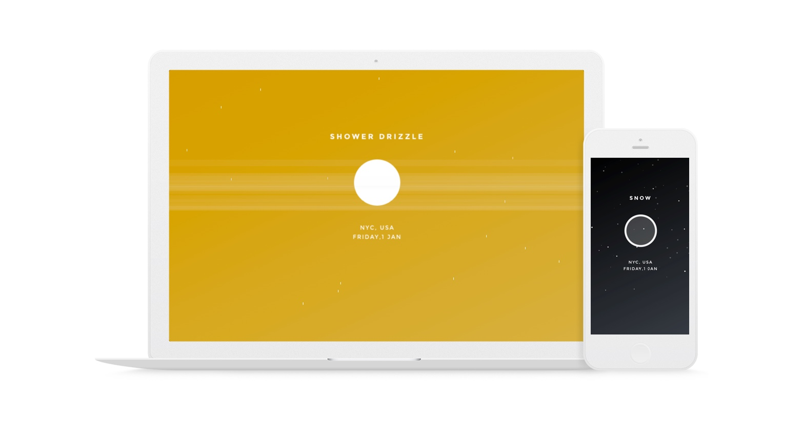

# Huecast

**Live:** https://huecast.netlify.app/

The 2016 data visualization weather app (then called Timecast), rebuilt for 2026. It keeps the same idea: one circle (sun or moon), a gradient made from **temperature × time of day**, and the weather drawn as particles (rain, snow, fog, cloud bands, stars, thunder).

## What's new

| | 2016 | v3 |
|---|---|---|
| Weather data | OpenWeatherMap (http, API key in the code) | [Open-Meteo](https://open-meteo.com) (HTTPS, no key) |
| City name | from the weather response | BigDataCloud reverse geocoding, plus **city search** |
| Rendering | hundreds of jQuery `<div>`s | one `<canvas>`, sized for the screen and paused when hidden |
| Dependencies | jQuery, animate.css | none, plain ES modules |
| Gradient | hard colour buckets | the same colours, blended smoothly |
| Time of day | device clock | **the location's local time**, with colours that follow the real sunrise and sunset |
| Forecast | – | **24-hour timeline**: drag to watch the sky change hour by hour |
| Temperature | hidden | shown, with "feels like" in the forecast bar; tap to switch °C/°F |
| Explore | – | in search: the coldest, hottest, wettest, snowiest, stormiest, foggiest and windiest places right now, and where it's golden hour; the dice opens one of them |
| Keep | – | **pin** places to the top of search, **save a scene** (place, hour and its 24-hour forecast) to open again later, save the screen as a picture |
| Clouds | one look per weather code | drawn from the measured cloud cover; thin high cloud lets the sun through |
| Wind | `@todo` | wind streaks, and the rain slants with the wind |
| Mobile | fixed paddings | safe areas, phone landscape, touch scrubbing, installable PWA, works offline |
| Accessibility | – | keyboard support, reduced motion, dark text on very light skies |

## Run

Plain static files, no build step. Serve the repo root over HTTP (ES modules don't load from `file://`):

```sh
python3 -m http.server 8000
# open http://localhost:8000
```

Geolocation needs `localhost` or HTTPS.

## URL options

- `?lat=40.4&lon=-3.7&name=Madrid` opens a fixed place (search and the dice set this, so links can be shared)
- `?city=random` opens a random capital city
- `?wallpaper` shows only the sky and the sun or moon, with no buttons, text or forecast bar (also **Options → Wallpaper**; tap to go back). Add it to any of the other options (e.g. `?lat=40.4&lon=-3.7&name=Madrid&wallpaper`) and use it as a macOS desktop background with [Plash](https://sindresorhus.com/plash). Use a fixed place, because wallpaper apps usually can't ask for your location
- `?wallpaper=info` is the clean view you get by tapping the sky: the weather, temperature, place and forecast bars stay, the buttons and the low · now · high row are hidden. Tapping adds or removes it from the URL
- `?demo` uses fake data with no network calls (the old development mode). You can pin values, e.g. `?demo&code=95&temp=24&hour=22&wind=40`. `code` is a [WMO weather code](https://open-meteo.com/en/docs#weather_variable_documentation).

## Shortcuts

`/` or `Ctrl/⌘ K` search · `R` random extreme weather · `←` `→` move through the forecast hours

## Files

```
index.html
how.html          "How it works", drawn with the app's own code
css/tokens.css    colours, shared by the CSS and the JS
css/style.css
css/how.css
js/app.js         startup, rendering, timeline, search, pins and saved scenes, demo mode
js/weather.js     Open-Meteo + geocoding calls
js/conditions.js  WMO code -> label + effects (successor of icons.js)
js/palette.js     original colours, blended
js/scene.js       canvas particles
js/cities.js      world capitals for random mode
js/explore.js     Explore in search: extreme places, ranked by live weather
js/picture.js     Save as picture: the screen drawn into a PNG
js/roll.js        odometer-style number changes
js/how.js         the "How it works" demos
sw.js             offline cache
```

## The 2016 version



The original jQuery + OpenWeatherMap version (v2.0, 5 feb 2016) is kept on the [`legacy-2016`](../../tree/legacy-2016) branch.
